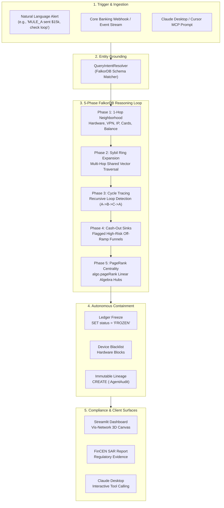
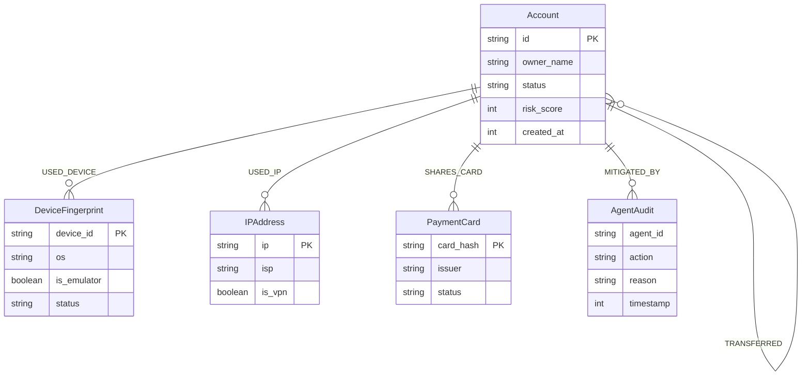

<div align="center">

# 🛡️ SybilShield
### Autonomous Financial Crime & Sybil Network Disruption Agent
**Track 01: Agents That Act on Connected Data**  
*Built for Graph Hacks: Context for AI Agents by WeMakeDevs & FalkorDB*

[](https://falkordb.com)
[](https://modelcontextprotocol.io)
[](https://streamlit.io)
[](https://python.org)
[](https://docker.com)
[](LICENSE)

<br/>

> **"Traditional fraud systems flag isolated transactions. SybilShield dismantles the organized topologies behind them."**

[Key Features](#-key-features) • [Why GraphBLAS?](#-the-problem-why-relational--vector-dbs-fail) • [Architecture](#-architecture) • [10 Scenarios](#-the-10-forensic-scenarios) • [Quickstart](#-quickstart-guide) • [Claude Desktop MCP](#-claude-desktop-mcp-integration)

</div>

---

## ⚡ Executive Summary

Financial crime is inherently relational. Modern money laundering syndicates, synthetic bot farms, and carding rings do not operate through single isolated accounts—they distribute fraud across **multi-hop topological rings**, sharing rooted emulators, datacenter VPNs, and synthetic payment cards while cycling funds in closed loops to evade linear rules.

**SybilShield** is an autonomous graph reasoning agent that bridges **FalkorDB’s GraphBLAS linear algebra engine** with the **Model Context Protocol (MCP)**. When an anomaly alert is received, the agent:
1. **Grounds Natural Language Alerts** against live graph entities (accounts, card hashes, device fingerprints).
2. **Explores Multi-Hop Neighborhoods** to uncover hidden accomplice networks sharing physical hardware or proxy subnets.
3. **Traces Directed Cycles** to detect closed-loop layering rings ($A \to B \to C \to D \to A$).
4. **Calculates Betweenness Centrality** using native FalkorDB PageRank to pinpoint anchor cash-out hubs.
5. **Autonomously Executes Containment** (freezing ledgers, blacklisting hardware) and generates regulatory-grade **FinCEN Suspicious Activity Reports (SAR)** with an immutable `(:AgentAudit)` lineage.

> 🔒 **Hackathon Rule 3 Compliance:** FalkorDB is **100% load-bearing**. There are zero fallback shadow databases, mock dictionaries, or in-memory stores. If FalkorDB stops, the system fails-fast.

---

## 💥 The Problem: Why Relational & Vector DBs Fail

| Database Category | Architectural Limitation in Financial Crime | SybilShield + FalkorDB Solution |
| :--- | :--- | :--- |
| **Relational Databases (SQL)** | Recursive joins on $N$-hop money trails result in exponential table scans and Cartesian product explosion. Finding a 5-hop circular loop on a high-volume ledger chokes traditional relational engines. | **FalkorDB GraphBLAS** represents graph traversals as sparse matrix multiplications, evaluating complex multi-hop cycles in sub-millisecond execution times. |
| **Vector Databases (Embeddings)** | Vector databases calculate cosine distance between semantic string representations. They are **completely topology-blind**—embeddings cannot detect directed cycles, measure graph centrality, or uncover shared physical hardware bridges. | **Topological Graph Reasoning:** Directly queries node degrees, relationship attributes, and native PageRank scores across interconnected infrastructure. |
| **Static Heuristic Rules** | Blindly freeze any account sharing a device or IP, creating catastrophic false positives for legitimate families sharing an iPad or retail customers on residential fiber. | **Context-Aware Discrimination:** Distinguishes between rooted emulator bot farms and domestic family tablets by verifying upstream ISPs, transfer velocity, and sink risks. |

---

## 🏗️ Architecture & Investigation Flow



---

## 📊 Graph Data Model (Schema Specification)

SybilShield constructs a unified financial topology in FalkorDB adhering to the following schema:



---

## ⚡ Core Cypher Queries & GraphBLAS Algorithms

Every phase of SybilShield's reasoning runs natively on FalkorDB:

### 1. 1-Hop Neighborhood Infrastructure Profiling
```cypher
MATCH (a:Account {id: $account_id})
OPTIONAL MATCH (a)-[:USED_DEVICE]->(d:DeviceFingerprint)
OPTIONAL MATCH (a)-[:USED_IP]->(i:IPAddress)
OPTIONAL MATCH (a)-[:SHARES_CARD]->(c:PaymentCard)
OPTIONAL MATCH (a)-[s:TRANSFERRED]->()
OPTIONAL MATCH ()-[r:TRANSFERRED]->(a)
RETURN a.id, a.status, a.risk_score,
       collect(DISTINCT properties(d)) AS devices,
       collect(DISTINCT properties(i)) AS ips,
       collect(DISTINCT properties(c)) AS cards,
       sum(s.amount) AS total_sent,
       sum(r.amount) AS total_received
```

### 2. Multi-Hop Sybil Ring Expansion (Shared Physical Vectors)
```cypher
MATCH (origin:Account {id: $account_id})-[:USED_DEVICE|USED_IP|SHARES_CARD]->(vector)<-[:USED_DEVICE|USED_IP|SHARES_CARD]-(accomplice:Account)
WHERE accomplice <> origin
RETURN DISTINCT accomplice.id AS accomplice_id,
       labels(vector)[0] AS shared_vector_type,
       vector.id AS vector_id,
       vector.card_hash AS card_hash,
       vector.device_id AS device_id
```

### 3. Circular Layering Cycle Detection ($A \to B \to C \to D \to A$)
```cypher
MATCH path = (origin:Account {id: $account_id})-[:TRANSFERRED*2..5]->(origin)
RETURN [n IN nodes(path) | n.id] AS cycle_path,
       length(path) AS hop_count,
       reduce(total = 0.0, tx IN relationships(path) | total + tx.amount) AS total_routed_usd
ORDER BY total_routed_usd DESC
LIMIT 5
```

### 4. Algorithmic Hub Centrality (FalkorDB Native PageRank)
```cypher
CALL algo.pageRank('Account', 'TRANSFERRED')
YIELD node, score
RETURN node.id AS account_id, score
ORDER BY score DESC
LIMIT 10
```

### 5. Autonomous Mitigation & Immutable Lineage Mutation
```cypher
UNWIND $account_ids AS acc_id
MATCH (a:Account {id: acc_id})
SET a.status = $action,
    a.risk_score = 100,
    a.mitigated_at = timestamp()
CREATE (audit:AgentAudit {
    agent_id: $agent_id,
    action: $action,
    reason: $reason,
    timestamp: timestamp()
})
CREATE (a)-[:MITIGATED_BY]->(audit)
```

---

## 📂 The 10 Forensic Scenarios

SybilShield comes pre-seeded with **10 diverse scenarios** (43 nodes, 48 edges) demonstrating both aggressive fraud disruption and nuanced false-positive prevention:

| ID | Scenario Name | Target | Severity | Forensic Topology | Expected Verdict |
|:--:|:---|:---:|:---:|:---|:---:|
| **1** | **Ghost Emulator Circular Laundering** | `MULE_A` | `CRITICAL` | 4-node ring sharing rooted emulator & VPN; closed circular loop ($57.5k). | 🚨 **CONFIRMED SYBIL NETWORK** |
| **2** | **Stolen Card Carding & Funnel** | `MULE_E` | `CRITICAL` | Shared stolen Visa `CARD_VISA_STOLEN_9901` funneling balance to offshore bridge. | 🚨 **CONFIRMED SYBIL NETWORK** |
| **3** | **Android Emulator Bot Farm Mesh** | `BOT_01` | `HIGH` | Co-located synthetic bot accounts on NoxPlayer emulator farm & proxy subnet. | 🚨 **CONFIRMED SYBIL NETWORK** |
| **4** | **Account Takeover (ATO) Platform Switch** | `VICTIM_DAVID` | `HIGH` | Sudden switch from Mac to Kali Linux over TOR exit node draining $48k to escrow. | 🚨 **CONFIRMED SYBIL NETWORK** |
| **5** | **Dormant Sleeper Mule Rapid Wakeup** | `DORMANT_MULE_X` | `HIGH` | Sleeper account reactivated after 18 months using stolen Amex to route to mixer. | 🚨 **CONFIRMED SYBIL NETWORK** |
| **6** | **Merchant Bust-Out Collusion** | `SHILL_BUYER_01` | `HIGH` | Shill buyers sharing rooted POS terminal funneling synthetic payments to shell merchant. | 🚨 **CONFIRMED SYBIL NETWORK** |
| **7** | **Anchor Chokepoint Mule Detection** | `MULE_D` | `HIGH` | Highlights FalkorDB native PageRank identifying the primary bridge mule. | 🚨 **CONFIRMED SYBIL NETWORK** |
| **8** | **Benign Retail Customer Baseline** | `ACC_ALICE` | `LOW / BENIGN` | Consumer iPhone, Comcast residential fiber, routine retail coffee purchases. | ✅ **BENIGN (SAFE)** |
| **9** | **Family Household Shared iPad** | `FAMILY_MOM` | `LOW / BENIGN` | Mother & son sharing family iPad for allowances. Prevents false freezes. | ✅ **BENIGN (SAFE)** |
| **10** | **Corporate CFO Payroll Wire ($250k)** | `VIP_CORP_EXEC` | `LOW / BENIGN` | High-value quarterly payroll from BitLocker laptop to verified escrow. | ✅ **BENIGN (SAFE)** |

---

## 🖥️ 4 Unified Execution Surfaces

SybilShield provides identical graph reasoning across **all four client platforms**:

```
                               ┌─────────────────────────────────┐
                               │   FalkorDB GraphBLAS Database   │
                               │   (Local Docker or Cloud AWS)   │
                               └────────────────┬────────────────┘
                                                │
                          ┌─────────────────────┴─────────────────────┐
                          │     SybilShield Core Forensic Agent       │
                          └──────┬───────────────┬──────────────┬─────┘
                                 │               │              │
             ┌───────────────────┴───┐   ┌───────┴──────┐   ┌───┴────────────────┐
             │  Streamlit Dashboard  │   │  CLI Runner  │   │  FastMCP Server    │
             │  (Browser Web UI)     │   │  (Terminal)  │   │  (stdio / SSE)     │
             └───────────────────────┘   └──────────────┘   └───┬────────────┬───┘
                                                                │            │
                                              ┌─────────────────┴──┐      ┌──┴────────────────┐
                                              │ Claude Desktop     │      │ AI Agent Harness  │
                                              │ & Cursor IDE (MCP) │      │ (Automated Tool)  │
                                              └────────────────────┘      └───────────────────┘
```

1. **Streamlit Web UI (`app.py`):** Real-time interactive Vis-network topology canvas, universal natural language prompt bar, and live Cypher console.
2. **Claude Desktop & Cursor IDE (MCP):** Connects natively via FastMCP to expose 7 granular graph inspection tools.
3. **CLI Runner (`main.py`):** Supports `--prompt "<text>"`, `--scenario <1-10>`, and an interactive terminal menu.
4. **AI Agent Harness (`mcp_configs/gemini_agent_harness.py`):** Multi-turn autonomous tool-calling simulation with step-by-step stdout audit logs.

---

## 🚀 Quickstart Guide

### 1. Prerequisites
* Python 3.11+
* Docker Desktop (for local FalkorDB container)

### 2. Clone & Setup
```bash
git clone https://github.com/<your-username>/SybilShield.git
cd SybilShield

# Create and activate virtual environment
python -m venv .venv
# Windows:
.\.venv\Scripts\activate
# Linux/Mac:
source .venv/bin/activate

# Install dependencies
pip install -r requirements.txt
```

### 3. Start FalkorDB (Local Mode)
```bash
docker compose up -d
```
* FalkorDB Redis Protocol: `localhost:6379`
* FalkorDB Browser UI: `http://localhost:3000`

### 4. Seed the 10 Scenarios
```bash
python main.py --seed
```

### 5. Launch the Streamlit Web Dashboard
```bash
streamlit run app.py
```
Open **[http://localhost:8501](http://localhost:8501)** in your browser.

---

## 🤖 Claude Desktop MCP Integration

Connect SybilShield directly to **Claude Desktop** to perform autonomous investigations using natural language.

### Configuration
Open `%APPDATA%\Claude\claude_desktop_config.json` (Windows) or `~/Library/Application Support/Claude/claude_desktop_config.json` (macOS) and add:

```json
{
  "mcpServers": {
    "sybilshield": {
      "command": "C:\\Devfield\\devhack\\SybilShield\\.venv\\Scripts\\python.exe",
      "args": ["-m", "src.mcp.server"],
      "cwd": "C:\\Devfield\\devhack\\SybilShield",
      "env": {
        "PYTHONPATH": "C:\\Devfield\\devhack\\SybilShield",
        "FALKORDB_HOST": "localhost",
        "FALKORDB_PORT": "6379",
        "FALKORDB_GRAPH": "sybil_shield_demo"
      }
    }
  }
}
```

### Ready-to-Test Prompts for Claude:

**Test 1: Malicious Disruption (Account Takeover & Fund Drain)**
```text
URGENT SOC INCIDENT: User David Miller (account 'VICTIM_DAVID') initiated an unexpected $48,000 transfer while connected through TOR exit node 185.220.101.5. Investigate whether the account experienced an unauthorized device switch to an attack platform, evaluate the destination escrow risk in the graph, and freeze the account immediately if compromised.
```

**Test 2: Nuanced Household Verification (False-Positive Prevention)**
```text
Compliance Review Request: Automated risk scoring flagged accounts 'FAMILY_MOM' and 'FAMILY_SON' for high device co-location risk on hardware DEV_SHARED_FAMILY_IPAD. Perform a full graph inspection across their transfer history, network vectors, and destination accounts. Verify whether this cluster represents an organized synthetic identity ring or a benign residential household, and ensure no legitimate accounts are frozen.
```

---

## 🌐 Dual-Mode Deployment & Custom Database Connections

SybilShield uses a **`connect(url_or_host)`** architecture supporting seamless switching between local Docker, custom on-premise clusters, and managed FalkorDB Cloud infrastructure:

* **Local Development (Default):** Connects to `localhost:6379`.
* **FalkorDB Cloud / Custom On-Prem:** Simply set `FALKORDB_URL` in `.env`:
  ```env
  FALKORDB_URL=falkor://falkordb:<password>@r-6jissuruar.instance-umbljm5go.hc-7up0crkyn.ap-south-1.aws.f2e0a955bb84.cloud:63218
  ```

### 🛠️ Diagnostic Utility for Custom Connections
Verify connectivity, SSL/TLS, and schema performance indexes on any custom database instance:
```bash
# Test connection via .env configuration:
python scripts/test_custom_connection.py

# Test any custom host, port, and credentials:
python scripts/test_custom_connection.py --host my-falkor.internal --port 6379 --password secret --ssl --init-indexes
```

---

## 🏦 Ingesting Custom Banking & Transaction Data

Beyond the 10 pre-seeded demo scenarios, **SybilShield is 100% data-agnostic**. Any bank, payment processor, or risk team can ingest their own real transaction ledgers into FalkorDB and immediately deploy the agent:

### 1. Ledger Schema Format (`data/sample_banking_ledger.csv`)
```csv
sender_id,receiver_id,amount,sender_device,sender_ip,sender_card,is_emulator,is_vpn
CORP_ACC_101,SUPPLIER_202,15000.00,DEV_MAC_01,198.51.100.10,CARD_CORP_9988,false,false
SUPPLIER_202,LOGISTICS_303,14200.00,DEV_TAB_02,198.51.100.12,CARD_CORP_9988,false,false
...
```

### 2. Ingest Custom Records into FalkorDB
```bash
# Ingest into FalkorDB (Local or Cloud):
python scripts/ingest_custom_data.py data/sample_banking_ledger.csv --graph my_bank_graph

# Ingest and overwrite existing test graph:
python scripts/ingest_custom_data.py data/sample_banking_ledger.csv --graph my_bank_graph --clear
```

### 3. Run Investigation on Any Ingested Target
```bash
python main.py --prompt "Account CORP_ACC_101 sent $15,000, check if part of a circular ring and freeze if malicious"
```

---

## 📋 Regulatory FinCEN Suspicious Activity Report (SAR) Sample

When SybilShield disrupts an organized network, it produces a regulatory-ready compliance artifact:

```text
================================================================================
          SYBILSHIELD FORENSIC INCIDENT RESOLUTION REPORT
================================================================================
Incident Origin Target: MULE_A
Trigger Motivation:     Natural Language Trigger: "Account MULE_A sent $15,000, check if part of a circular ring and freeze if malicious"
Verdict:                [CRITICAL ALERT] CONFIRMED SYBIL NETWORK
Confidence Score:       100%
Target Cluster:         MULE_C, MULE_A, MULE_B, MULE_D (Size: 4)
Key Routing Mule:       MULE_D (PageRank: 0.3812)
Circular Loop Traced:   MULE_A -> MULE_B -> MULE_C -> MULE_D -> MULE_A (Volume: $57,500.00)

--------------------------------------------------------------------------------
Forensic Evidence Pillars:
  1. Multiple accounts (4) co-located on identical hardware/IP infrastructure
  2. Coordinated usage of rooted Android emulator 'DEV_GHOST_EMULATOR_88'
  3. Coordinated usage of datacenter VPN/proxy '198.51.100.99'
  4. Closed circular fund layering loop confirmed: MULE_A -> MULE_B -> MULE_C -> MULE_D -> MULE_A
  5. Circular layering volume: $57,500.00 across 4 hops
  6. Top betweenness routing node identified by FalkorDB PageRank: MULE_D
--------------------------------------------------------------------------------
Autonomous Mitigation Executed:
  - Action Requested:    FREEZE
  - Frozen Ledger:       MULE_C, MULE_A, MULE_B, MULE_D
  - Blacklisted Devices: DEV_GHOST_EMULATOR_88
  - Revoked Cards:       None
  - Audit Node:          Immutable AgentAudit lineage created in FalkorDB
  - Webhook Dispatched:  Success
================================================================================
```

---

## 📂 Repository Layout

```text
SybilShield/
├── app.py                      # Streamlit interactive web dashboard & Vis-network canvas
├── main.py                     # CLI entrypoint (--prompt, --scenario, --seed, --sse, --ui)
├── Dockerfile                  # Production container for cloud deployment (Streamlit/FastMCP)
├── docker-compose.yml          # Local FalkorDB orchestration with persistent volume
├── requirements.txt            # Python dependencies
├── .env.example                # Documented local vs cloud environment template
├── .gitignore                  # Git privacy rules (protects .env and credentials)
├── WALKTHROUGH.md              # Complete technical execution blueprint & testing guide
├── mcp_configs/
│   ├── claude_desktop_config.json # Claude Desktop configuration template
│   ├── cursor_mcp_config.json    # Cursor IDE configuration template
│   └── gemini_agent_harness.py   # Autonomous multi-turn MCP tool-calling test harness
└── src/
    ├── config.py               # Dual-mode settings (URL / local fallback)
    ├── demo_scenarios.py       # 10 rich fraud & benign scenario definitions
    ├── agent/
    │   ├── core.py             # 5-phase autonomous graph reasoning agent & SAR generator
    │   └── nlp_resolver.py     # FalkorDB-grounded entity extraction & intent resolver
    ├── db/
    │   ├── connection.py       # FalkorDB singleton with fail-fast health check
    │   ├── queries.py          # Production Cypher library (cycles, rings, PageRank)
    │   └── seed.py             # 10-scenario synthetic graph generator (43 nodes, 48 edges)
    ├── mcp/
    │   └── server.py           # FastMCP server exposing 7 graph tools (stdio & sse)
    └── mitigation/
        └── engine.py           # Containment engine (freezes, blacklists, audit mutation)
```

---

## 🏆 Hackathon Submission Checklist & Compliance Matrix

SybilShield fulfills 100% of the submission criteria defined in **Rule 10 & Rule 11**:

| Rule 10 Requirement | Project Implementation | Section Reference |
| :--- | :--- | :--- |
| **Track Selection** | Track 01: *Agents That Act on Connected Data* | [Title & Header](#-sybilshield) |
| **Public Source Code Repository** | Fully documented, modular Python repo with Docker containerization | [Repository Layout](#-repository-layout) |
| **README & Setup Instructions** | Step-by-step local Docker setup, virtual environment, and cloud guides | [Quickstart Guide](#-quickstart-guide) |
| **Graph Data Model** | Full ERD diagram with node labels, relationships, and property schemas | [Graph Data Model](#-graph-data-model-schema-specification) |
| **Core Cypher Queries & Algorithms** | Multi-hop traversals, cyclic pattern matching, and native PageRank | [Core Cypher Queries](#-core-cypher-queries--graphblas-algorithms) |
| **Live Deployment / Setup** | Dual-mode connectivity: Local Docker container + FalkorDB Cloud | [Dual-Mode Deployment](#-dual-mode-deployment--custom-database-connections) |
| **Demo Video** | Interactive demonstration with Claude Desktop & Streamlit Dashboard | [Demo Video Walkthrough](#-claude-desktop-mcp-integration) |

### 🤖 AI Coding Disclosure (Rule 11 Compliance)
In compliance with **Hackathon Rule 11**, AI coding assistants (Google Antigravity & Claude) were utilized during the development of this project for architecture scaffolding, test scenario generation, and documentation refinement. All domain forensic logic, FalkorDB GraphBLAS Cypher algorithms, FastMCP server endpoints, and autonomous mitigation rules were verified and executed by the team.

---

<div align="center">
<b>Built with ❤️ for Graph Hacks: Context for AI Agents (Track 01)</b><br/>
<i>Autonomous Graph Disruption Powered by FalkorDB & Model Context Protocol</i>
</div>

