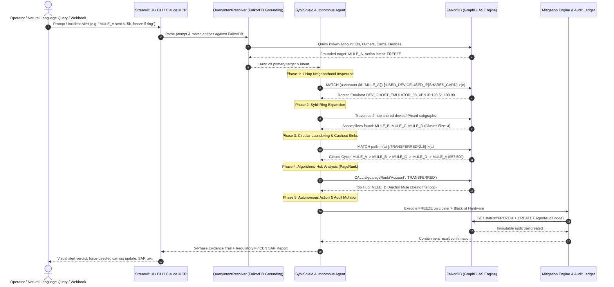

# 🛡️ SybilShield: End-to-End System Walkthrough & Execution Blueprint

---

## 1. Executive Summary & Hackathon Scope

**SybilShield** is an autonomous financial crime and Sybil network disruption agent built for **Graph Hacks: Context for AI Agents** (Track 01: *Agents That Act on Connected Data*), powered by **FalkorDB** and the **Model Context Protocol (MCP)**.

> 🎥 **Official Video Demonstration:** [Watch the 3-Minute Walkthrough on YouTube (https://youtu.be/AGz4LOvmB8o)](https://youtu.be/AGz4LOvmB8o)

### Why Relational DBs and Vector DBs Fail:
* **Relational Databases (SQL):** Struggle with recursive multi-hop joins. Tracing an arbitrary $N$-hop money laundering loop or co-located device ring requires recursive CTEs that degrade exponentially under production loads.
* **Vector Databases (Embeddings):** Capture semantic similarities between strings or text embeddings, but are completely **topology-blind**. A vector index cannot detect a directed cycle ($A \to B \to C \to D \to A$), nor can it compute betweenness centrality or identify shared hardware chokepoints.

### The FalkorDB Advantage:
SybilShield relies on **FalkorDB's GraphBLAS sparse-matrix linear algebra engine** to evaluate graph topology in sub-millisecond execution times. When an anomaly alert triggers, the agent autonomously navigates the connected graph, detects shared physical vectors, traces closed laundering loops, pinpoints central cash-out hubs, and executes ledger-level containment actions with an immutable audit trail.

> **Hackathon Rule 3 Compliance:** FalkorDB is **100% load-bearing**. There are no fallback dictionaries, mock databases, or shadow in-memory stores. If FalkorDB stops, the system fails-fast.

---

## 2. End-to-End Architectural Flow



---

## 3. The 10 Comprehensive Fraud & Benign Scenarios

SybilShield comes pre-seeded with **10 diverse scenarios** (43 nodes, 48 edges) demonstrating both offensive disruption and nuanced false-positive prevention:

| ID | Scenario Name | Target Account | Severity | Topology Description | Expected Verdict |
| :---: | :--- | :---: | :---: | :--- | :---: |
| **1** | **Ghost Emulator Circular Laundering Ring** | `MULE_A` | `CRITICAL` | 4-node ring sharing rooted emulator & VPN; cyclic transfers ($57.5k). | 🚨 **CONFIRMED SYBIL NETWORK** |
| **2** | **Stolen Credit Card Carding & Funnel Ring** | `MULE_E` | `CRITICAL` | Accounts share stolen Visa `CARD_VISA_STOLEN_9901`; funnel into offshore sink. | 🚨 **CONFIRMED SYBIL NETWORK** |
| **3** | **Android Emulator Bot Farm / Sybil Mesh** | `BOT_01` | `HIGH` | Bot accounts sharing NoxPlayer emulator farm and proxy subnet. | 🚨 **CONFIRMED SYBIL NETWORK** |
| **4** | **Account Takeover (ATO) Sudden Hardware Switch** | `VICTIM_DAVID` | `HIGH` | Legitimate account hijacked via Kali Linux & TOR to drain $48,000 to escrow. | 🚨 **CONFIRMED SYBIL NETWORK** |
| **5** | **Dormant Sleeper Mule Rapid Reactivation** | `DORMANT_MULE_X` | `HIGH` | Sleeper account reactivated after 18 months using stolen Amex to route to mixer. | 🚨 **CONFIRMED SYBIL NETWORK** |
| **6** | **Merchant Bust-Out Collusion via Shill Buyers** | `SHILL_BUYER_01` | `HIGH` | Shill buyers sharing rooted POS tablet funneling synthetic payments to shell merchant. | 🚨 **CONFIRMED SYBIL NETWORK** |
| **7** | **Anchor Chokepoint Mule Detection (PageRank)** | `MULE_D` | `HIGH` | Highlights FalkorDB native PageRank isolating the primary routing hub in a cycle. | 🚨 **CONFIRMED SYBIL NETWORK** |
| **8** | **Benign Retail Customer (Baseline Audit)** | `ACC_ALICE` | `LOW / BENIGN` | Consumer iPhone, residential fiber ISP, retail coffee payments. **Never frozen.** | ✅ **BENIGN TOPOLOGY** |
| **9** | **Family Household Shared iPad (Nuanced False Positive)** | `FAMILY_MOM` | `LOW / BENIGN` | Mother & son sharing family iPad for allowances. Proves SybilShield avoids false freezes. | ✅ **BENIGN TOPOLOGY** |
| **10** | **Corporate CFO Payroll Wire ($250,000 Volume)** | `VIP_CORP_EXEC` | `LOW / BENIGN` | High dollar payroll from BitLocker enterprise laptop to Deloitte escrow. Verified safe. | ✅ **BENIGN TOPOLOGY** |

---

## 4. The 4 Unified Execution Surfaces

SybilShield provides **100% consistent execution** across four different client interfaces. Any natural language query or scenario runs through the exact same FalkorDB graph reasoning pipeline:

```
               ┌────────────────────────────────────────────────────────┐
               │           FalkorDB GraphBLAS Engine (:6379)            │
               │   43 Nodes | 48 Edges | Native Cypher & PageRank       │
               └──────────────────────────┬─────────────────────────────┘
                                          │
                   ┌──────────────────────┴──────────────────────┐
                   │  SybilShield Core Agent & Mitigation Engine │
                   │  (src/agent/core.py | src/agent/nlp_resolver.py)
                   └──────┬───────────────┬──────────────┬───────┘
                          │               │              │
      ┌───────────────────┴───┐   ┌───────┴──────┐   ┌───┴────────────────┐
      │  Streamlit Dashboard  │   │  CLI Runner  │   │  FastMCP Server    │
      │  (http://localhost:   │   │  (main.py)   │   │  (stdio / SSE)     │
      │   8501)               │   │              │   │  src/mcp/server.py │
      └───────────────────────┘   └──────────────┘   └───┬────────────┬───┘
                                                         │            │
                                       ┌─────────────────┴──┐      ┌──┴────────────────┐
                                       │ Claude Desktop     │      │ AI Agent Harness  │
                                       │ & Cursor IDE (MCP) │      │ (gemini_agent_    │
                                       └────────────────────┘      │  harness.py)      │
                                                                   └───────────────────┘
```

### Surface 1: Streamlit Web Dashboard (`app.py`)
* **URL:** `http://localhost:8501`
* **Features:**
  * **Autonomous Natural Language Investigation Console:** Enter any arbitrary incident report, stolen card alert, or query and hit **Enter**.
  * **Interactive Vis-Network Canvas:** Force-directed live topology view (Frozen Accounts in Red, Active Accounts in Purple, Emulators in Orange, Cards in Yellow).
  * **5-Phase Reasoning Trail:** Expandable phase-by-phase JSON evidence views.
  * **Live FalkorDB Cypher Studio:** Execute ad-hoc Cypher queries directly against GraphBLAS with millisecond execution latency metrics.
  * **Regulatory SAR Downloader:** One-click `.txt` download of FinCEN-compliant Suspicious Activity Reports.

### Surface 2: CLI Runner (`main.py`)
* **Arbitrary Prompt Execution:** `python main.py --prompt "<any natural language alert>"`
* **Specific Scenario Execution:** `python main.py --scenario <1-10>`
* **Direct Account Inspection:** `python main.py --account <ID>`
* **Interactive Terminal Menu:** `python main.py` (Options 1–8)

### Surface 3: AI Agent MCP Harness (`mcp_configs/gemini_agent_harness.py`)
* **Prompt Mode:** `python mcp_configs/gemini_agent_harness.py --prompt "<query>"`
* **Scenario Mode:** `python mcp_configs/gemini_agent_harness.py --scenario <1-10>`
* **Execution Style:** Simulates autonomous multi-turn tool calling across FalkorDB MCP tools (`investigate_account`, `detect_sybil_ring`, `trace_fund_cycles`, `calculate_ring_centrality`, `execute_mitigation`).

### Surface 4: Claude Desktop & Cursor IDE (Model Context Protocol)
* **Configuration:** Added to Claude Desktop / Cursor `config.json` via stdio.
* **Exposed Tools:**
  1. `investigate_natural_language_prompt(prompt)`: End-to-end prompt resolution and disruption.
  2. `investigate_account(account_id)`: 1-hop infrastructure profile.
  3. `detect_sybil_ring(account_id, max_hops)`: Multi-hop vector clustering.
  4. `trace_fund_cycles(account_id, max_hops)`: Cyclic laundering loop detection.
  5. `calculate_ring_centrality(top_k)`: FalkorDB PageRank centrality.
  6. `execute_mitigation(action, account_ids, reason)`: Ledger freezing & audit logging.
  7. `blacklist_compromised_instrument(instrument_type, instrument_id, reason)`: Hardware/card blocking.

---

## 5. Technical Architecture & Cypher Query Engine

### 1-Hop Neighborhood Profiling
```cypher
MATCH (a:Account {id: $account_id})
OPTIONAL MATCH (a)-[:USED_DEVICE]->(d:DeviceFingerprint)
OPTIONAL MATCH (a)-[:USED_IP]->(i:IPAddress)
OPTIONAL MATCH (a)-[:SHARES_CARD]->(c:PaymentCard)
OPTIONAL MATCH (a)-[s:TRANSFERRED]->()
OPTIONAL MATCH ()-[r:TRANSFERRED]->(a)
RETURN a.id, a.status, a.risk_score,
       collect(DISTINCT properties(d)) AS devices,
       collect(DISTINCT properties(i)) AS ips,
       collect(DISTINCT properties(c)) AS cards,
       sum(s.amount) AS total_sent,
       sum(r.amount) AS total_received
```

### 2-Hop Sybil Ring Expansion
```cypher
MATCH (origin:Account {id: $account_id})-[:USED_DEVICE|USED_IP|SHARES_CARD]->(vector)<-[:USED_DEVICE|USED_IP|SHARES_CARD]-(accomplice:Account)
WHERE accomplice <> origin
RETURN DISTINCT accomplice.id AS accomplice_id,
       labels(vector)[0] AS shared_vector_type,
       vector.id AS vector_id,
       vector.card_hash AS card_hash,
       vector.device_id AS device_id
```

### Cyclic Money Laundering Detection
```cypher
MATCH path = (origin:Account {id: $account_id})-[:TRANSFERRED*2..5]->(origin)
RETURN [n IN nodes(path) | n.id] AS cycle_path,
       length(path) AS hop_count,
       reduce(total = 0.0, tx IN relationships(path) | total + tx.amount) AS total_routed_usd
ORDER BY total_routed_usd DESC
LIMIT 5
```

### FalkorDB Native PageRank Procedure
```cypher
CALL algo.pageRank('Account', 'TRANSFERRED')
YIELD node, score
RETURN node.id AS account_id, score
ORDER BY score DESC
LIMIT 10
```

### Autonomous Mitigation & Lineage Audit Mutation
```cypher
UNWIND $account_ids AS acc_id
MATCH (a:Account {id: acc_id})
SET a.status = $action,
    a.risk_score = 100,
    a.mitigated_at = timestamp()
CREATE (audit:AgentAudit {
    agent_id: $agent_id,
    action: $action,
    reason: $reason,
    timestamp: timestamp()
})
CREATE (a)-[:MITIGATED_BY]->(audit)
```

---

## 6. Testing Guide (How to Run Everything in 12 Hours)

When you are ready to test the system, follow these exact steps:

### Step 1: Verify FalkorDB Container Health
In your terminal:
```powershell
docker ps
```
Confirm `sybilshield-falkordb` is running on ports `6379` (Redis protocol) and `3000` (FalkorDB Browser). If not running, start it:
```powershell
docker compose up -d
```

### Step 2: Test via the Streamlit Web UI
1. Open your browser to **[http://localhost:8501](http://localhost:8501)**.
2. In the **Autonomous Natural Language Investigation Console** at the top, type any of these sample prompts and hit **Enter**:
   * `"Account MULE_A just sent $15,000, check if part of a circular ring and freeze if malicious"`
   * `"Issuer alert: card CARD_VISA_STOLEN_9901 was stolen and used by MULE_E, isolate the network"`
   * `"Audit customer ACC_ALICE to confirm if benign"`
   * `"BOT_01 suspected of emulator bot farm, inspect shared hardware and freeze"`
   * `"Account VICTIM_DAVID suddenly attempted a $48,000 transfer, check device switch"`
3. Verify that the UI displays:
   * **🧠 NLP Grounding from FalkorDB:** Shows the extracted target, linked cards/devices, and action intent.
   * **Verdicts:** Red alert banner for fraud rings; Green verification banner for benign accounts.
   * **5-Phase Reasoning Trail:** Expand each phase to inspect raw graph evidence.
   * **Regulatory SAR Report:** Formatted Suspicious Activity Report with `.txt` download button.
4. Click on **Tab 2: Interactive Topology Canvas** to see the live Vis-network graph. Frozen accounts will display as red nodes.
5. Click on **Tab 3: FalkorDB Cypher Studio** to test raw Cypher queries directly against FalkorDB.

### Step 3: Test via CLI Runner
From `C:\Devfield\devhack\SybilShield`:
```powershell
# Run a freeform natural language query:
.\.venv\Scripts\python.exe main.py --prompt "Stolen card CARD_VISA_STOLEN_9901 used on account MULE_E, freeze the ring"

# Run any of the 10 pre-packaged scenarios (e.g. Scenario 1):
.\.venv\Scripts\python.exe main.py --scenario 1

# Launch the interactive menu:
.\.venv\Scripts\python.exe main.py
```

### Step 4: Test via AI Agent MCP Harness
```powershell
# Test a custom prompt via simulated multi-turn tool calling:
.\.venv\Scripts\python.exe mcp_configs/gemini_agent_harness.py --prompt "VICTIM_DAVID sudden wire to TOR escrow"

# Test a pre-packaged scenario:
.\.venv\Scripts\python.exe mcp_configs/gemini_agent_harness.py --scenario 2
```

### Step 5: Inspect FalkorDB Browser
1. Open **[http://localhost:3000](http://localhost:3000)** in your browser.
2. Select graph: `sybil_shield_demo`.
3. Run this query to view all frozen accounts and their attached audit nodes:
   ```cypher
   MATCH (a:Account {status: 'FROZEN'})-[:MITIGATED_BY]->(audit:AgentAudit)
   RETURN a.id, a.risk_score, audit.reason, audit.timestamp
   ```
4. Run this query to reset the graph at any time:
   ```powershell
   .\.venv\Scripts\python.exe main.py --seed
   ```

---

## 7. Sample FinCEN Suspicious Activity Report (SAR)

```text
================================================================================
          SYBILSHIELD FORENSIC INCIDENT RESOLUTION REPORT
================================================================================
Incident Origin Target: MULE_A
Trigger Motivation:     Natural Language Trigger: "Account MULE_A sent $15,000, check if part of a circular ring and freeze if malicious"
Verdict:                [CRITICAL ALERT] CONFIRMED SYBIL NETWORK
Confidence Score:       100%
Target Cluster:         MULE_C, MULE_A, MULE_B, MULE_D (Size: 4)
Key Routing Mule:       MULE_D (PageRank: 0.3812)
Circular Loop Traced:   MULE_A -> MULE_B -> MULE_C -> MULE_D -> MULE_A (Volume: $57,500.00)

--------------------------------------------------------------------------------
Forensic Evidence Pillars:
  1. Multiple accounts (4) co-located on identical hardware/IP infrastructure
  2. Coordinated usage of rooted Android emulator 'DEV_GHOST_EMULATOR_88'
  3. Coordinated usage of datacenter VPN/proxy '198.51.100.99'
  4. Closed circular fund layering loop confirmed: MULE_A -> MULE_B -> MULE_C -> MULE_D -> MULE_A
  5. Circular layering volume: $57,500.00 across 4 hops
  6. Top betweenness routing node identified by FalkorDB PageRank: MULE_D
--------------------------------------------------------------------------------
Autonomous Mitigation Executed:
  - Action Requested:    FREEZE
  - Frozen Ledger:       MULE_C, MULE_A, MULE_B, MULE_D
  - Blacklisted Devices: DEV_GHOST_EMULATOR_88
  - Revoked Cards:       None
  - Audit Node:          Immutable AgentAudit lineage created in FalkorDB
  - Webhook Dispatched:  Success
================================================================================
```

---

## 8. Custom Database Connection & Banking Ingestion Blueprint

Beyond the 10 pre-packaged demo scenarios, SybilShield is built to seamlessly attach to **any real bank database or custom FalkorDB deployment** (on-premise, AWS, GCP, Azure, or FalkorDB Cloud).

### Step 1: Diagnose & Test Any Custom Database Connection
Use the diagnostic utility to verify connectivity, SSL, and schema indexes:
```powershell
# Test connection using .env configuration:
.\.venv\Scripts\python.exe scripts/test_custom_connection.py

# Test any custom host, port, credentials, and initialize performance indexes:
.\.venv\Scripts\python.exe scripts/test_custom_connection.py --host my-falkor.internal --port 6379 --password secret --ssl --init-indexes
```

### Step 2: Ingest Real Banking Ledger Data (CSV / JSON)
Banks and FinTechs can stream transaction and hardware events into FalkorDB using our ingestion utility:
```powershell
# Ingest custom banking ledger into a new target graph:
.\.venv\Scripts\python.exe scripts/ingest_custom_data.py data/sample_banking_ledger.csv --graph enterprise_bank_graph

# Inspect the ingested graph using the agent CLI:
.\.venv\Scripts\python.exe main.py --prompt "Account CORP_ACC_101 sent $15,000, check if part of a circular ring and freeze if malicious"
```

---

*Document prepared for Hackathon Evaluation & Local Demo Testing.*
